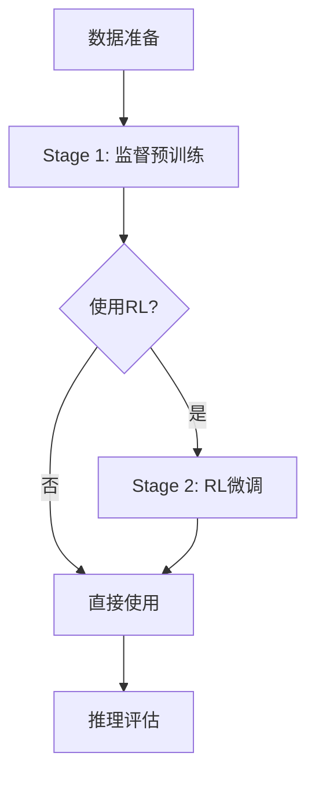

# DLWM 使用指南

本指南将帮助你快速上手使用DLWM (Diverse Latent World Models) 框架。

## 目录

1. [环境设置](#环境设置)
2. [快速开始](#快速开始)
3. [训练流程](#训练流程)
4. [推理使用](#推理使用)
5. [常见问题](#常见问题)

## 环境设置

### 1. 安装依赖

```bash
# 创建conda环境
conda env create -f environment.yaml
conda activate train

# 安装依赖（默认配置使用 PyTorch SDPA，不强制依赖 FlashAttention）
pip install -r requirements.txt
```

### 2. 验证安装

```python
import torch
from transformers import AutoTokenizer

# 检查CUDA
print(f"CUDA available: {torch.cuda.is_available()}")
print(f"CUDA version: {torch.version.cuda}")

# 检查模型加载
tokenizer = AutoTokenizer.from_pretrained("Qwen/Qwen2.5-VL-7B-Instruct")
print("Model loaded successfully!")
```

## 快速开始

### 1. 准备数据

编辑官方数据路径并生成带 split 校验的训练清单：

```bash
python scripts/prepare_dlwm_data.py \
  --config configs/data/dlwm_official_train.yaml
```

训练数据只允许 GQA balanced train、VQAv2 train2014 和 ScienceQA train。
MMVP 会被构建脚本拒绝，以保证论文要求的 zero-shot 评测。

### 2. 训练模型

#### Stage 1: 监督预训练

```bash
bash scripts/finetune_dlwm_stage1_7b.sh
```

这个阶段训练多世界推理能力，使用正交正则化鼓励不同世界的隐向量沿不同方向表示输入。

**预期输出：**
```
==================================================
DLWM Training Script
==================================================
Model: Qwen/Qwen2.5-VL-7B-Instruct
Data path: ./data/dlwm_official/train_dlwm.json
Enable DLWM: True
Number of worlds: 4
Compute budget: 10
Lambda orth: 0.1
Lambda steps: 0.05
Lambda worlds: 0.1
==================================================
```

#### Stage 2: RL微调（可选）

```bash
bash scripts/finetune_dlwm_stage2_7b.sh
```

这个阶段使用强化学习优化计算分配策略。

### 3. 评估模型

```python
from src.model.qwen_dlwm_model import QwenWithDLWM
from transformers import AutoTokenizer, AutoProcessor

# 加载模型
model = QwenWithDLWM.from_pretrained(
    "./output/dlwm_stage1_7b/checkpoint-2500",
    enable_dlwm=True,
    dlwm_use_rl=True,
    torch_dtype=torch.bfloat16
).cuda()

tokenizer = AutoTokenizer.from_pretrained("./output/dlwm_stage1_7b")
processor = AutoProcessor.from_pretrained("./output/dlwm_stage1_7b")

# 准备输入
question = "<image>\nDescribe what you see in this image."
image = "path/to/image.jpg"

# 生成
inputs = processor(
    text=[question],
    images=[image],
    return_tensors="pt"
).to("cuda")

outputs = model.generate_with_dlwm(
    **inputs,
    max_new_tokens=256,
    num_beams=1,  # 可设置为 >1；world cache 会随 beam 安全重排
    enable_dlwm=True,
    dlwm_use_rl=True,
    dlwm_max_steps=8
)

print(tokenizer.decode(outputs[0], skip_special_tokens=True))
```

## 训练流程

### 完整训练流程



### Stage 1: 监督预训练详解

**目标：** 学习多世界表示和正交约束

**损失函数：**
```
L_total = L_task + λ_orth × L_orth

其中：
- L_task: 标准语言建模损失
- L_orth = Σ_{i≠j} (w_i^T w_j)^2: 正交正则化
- λ_orth: 正则化权重（默认0.1）
```

**训练配置：**
```bash
--enable_dlwm true              # 启用DLWM
--dlwm_num_worlds 4            # 4个潜在世界
--dlwm_compute_budget 10        # 计算预算
--dlwm_lambda_orth 0.1         # 正交正则化权重
--dlwm_use_rl false            # 不使用RL（Stage 1）
--dlwm_max_steps 8             # 最大推理步数
--num_train_epochs 1            # 训练轮数
--learning_rate 2e-5            # 学习率
--per_device_train_batch_size 1  # 每设备batch size
--gradient_accumulation_steps 8   # 梯度累积
```

**监控指标：**
- `loss`: 总损失
- `task_loss`: 任务损失
- `orth_loss`: 正交损失（应该逐渐降低）
- `dlwm_num_steps`: 平均推理步数
- `dlwm_active_worlds`: 活跃世界数

### Stage 2: RL微调详解

**目标：** 学习自适应计算分配策略

**奖励函数：**
```
R = R_acc - λ_steps × T - λ_worlds × K_avg

其中：
- R_acc: 任务准确率奖励（0-1）
- T: 推理步数
- K_avg: controller 各决策步的平均活跃世界数
- λ_steps: 步数惩罚权重（默认0.05）
- λ_worlds: 世界数惩罚权重（默认0.1）
```

**训练配置：**
```bash
--dlwm_stage stage2             # 启用第二阶段 REINFORCE
--dlwm_use_rl true              # 使用动态 controller
--dlwm_max_steps 8              # 最大推理步数
--dlwm_rl_lambda 0.01           # RL损失权重
--dlwm_rl_baseline moving_average
```

**策略优化：**
使用REINFORCE算法优化策略网络：
```
∇_θ J(θ) = E[∇_θ log π_θ(a|s) × R]
```

## 推理使用

### 基本推理

```python
from src.model.qwen_dlwm_model import QwenWithDLWM

# 加载模型
model = QwenWithDLWM.from_pretrained(
    "path/to/checkpoint",
    enable_dlwm=True
)

# 生成
outputs = model.generate_with_dlwm(
    inputs,
    dlwm_use_rl=True,      # 使用RL策略
    dlwm_max_steps=8,      # 最大步数
    max_new_tokens=256
)
```

### 批量推理

```python
def batch_inference(model, processor, image_paths, questions, batch_size=4):
    """批量推理函数"""
    results = []
    
    for i in range(0, len(image_paths), batch_size):
        batch_images = image_paths[i:i+batch_size]
        batch_questions = questions[i:i+batch_size]
        
        # 准备输入
        inputs = processor(
            text=batch_questions,
            images=batch_images,
            return_tensors="pt",
            padding=True
        ).to(model.device)
        
        # 生成
        with torch.no_grad():
            outputs = model.generate_with_dlwm(
                **inputs,
                max_new_tokens=256,
                enable_dlwm=True,
                dlwm_use_rl=True
            )
        
        # 解码
        for output in outputs:
            result = tokenizer.decode(output, skip_special_tokens=True)
            results.append(result)
    
    return results
```

### 获取DLWM统计信息

```python
# 获取DLWM配置统计
stats = model.get_dlwm_statistics()
print(f"Number of worlds: {stats['num_worlds']}")
print(f"Compute budget: {stats['compute_budget']}")

# 获取推理时的统计信息
outputs = model.generate_with_dlwm(
    inputs,
    enable_dlwm=True,
    dlwm_use_rl=True,
    return_dict_in_generate=True,
    output_hidden_states=True
)

if 'dlwm_results' in outputs:
    dlwm_stats = outputs['dlwm_results']
    print(f"Reasoning steps: {dlwm_stats['num_steps']}")
    print(f"Active worlds: {dlwm_stats['num_active_worlds']}")
    print(f"World weights: {dlwm_stats['world_weights']}")
```

## 常见问题

### Q1: 训练时显存不足怎么办？

**解决方案：**
1. 减少batch size
   ```bash
   --per_device_train_batch_size 1
   --gradient_accumulation_steps 16  # 增加梯度累积
   ```

2. 使用DeepSpeed ZeRO-3
   ```bash
   --deepspeed scripts/zero3_offload.json
   ```

3. 减少潜在世界数量
   ```bash
   --dlwm_num_worlds 2  # 从4减少到2
   ```

### Q2: 正交损失不下降怎么办？

**可能原因：**
- 世界初始化不正交
- 正则化权重太低

**解决方案：**
1. 增加正交化权重
   ```bash
   --dlwm_lambda_orth 0.5  # 从0.1增加到0.5
   ```

2. 检查世界嵌入初始化
   ```python
   # 在dlwm_modules.py中检查_init_world_embeddings方法
   ```

3. 使用更强的正交约束
   ```python
   # 可以尝试添加对比学习损失
   ```

### Q3: 推理速度太慢怎么办？

**解决方案：**
1. 启用RL策略自适应计算
   ```bash
   --dlwm_use_rl true
   ```

2. 降低最大步数
   ```bash
   --dlwm_max_steps 4  # 从8降到4
   ```

3. 减少世界数量
   ```bash
   --dlwm_num_worlds 2
   ```

4. 使用Flash Attention
   ```bash
   # 确保安装了flash-attn
   pip install flash-attn --no-build-isolation
   ```

### Q4: 如何调试DLWM训练？

**调试技巧：**

1. 监控多个损失分量
   ```python
   # 在tensorboard或wandb中查看
   - loss: 总损失
   - task_loss: 任务损失
   - orth_loss: 正交损失（应该逐渐降低）
   - dlwm_num_steps: 平均步数（RL阶段应该优化）
   - dlwm_active_worlds: 活跃世界数
   ```

2. 检查世界多样性
   ```python
   # 在训练循环中添加检查
   dlwm_results = model_outputs['dlwm_results']
   world_reprs = dlwm_results['world_reprs']
   
   # 计算世界间的余弦相似度
   for i in range(K):
       for j in range(i+1, K):
           sim = F.cosine_similarity(
               world_reprs[:, i], 
               world_reprs[:, j]
           )
           print(f"World {i}-{j} similarity: {sim.mean():.3f}")
   ```

3. 可视化推理轨迹
   ```python
   # 保存每个世界的推理过程
   reasoning_trajectories = []
   for step in range(max_steps):
       # 保存当前状态
       state = {
           'step': step,
           'worlds': current_worlds,
           'active_mask': active_mask
       }
       reasoning_trajectories.append(state)
   ```

### Q5: 如何调整超参数？

**调参指南：**

| 参数 | 低值效果 | 高值效果 | 推荐 |
|------|----------|----------|------|
| `dlwm_num_worlds` | 速度快，但多样性低 | 多样性高，但速度慢 | 4 |
| `dlwm_compute_budget` | 计算不足，性能下降 | 性能提升但速度慢 | 10 |
| `dlwm_lambda_orth` | 世界相似，坍缩 | 世界差异大 | 0.1 |
| `dlwm_lambda_steps` | 步数多，计算慢 | 步数少，速度快 | 0.05 |
| `dlwm_lambda_worlds` | 世界多，计算慢 | 世界少，速度快 | 0.1 |

**调参策略：**
1. 先固定K=4, B=10
2. 调整λ_orth直到orth_loss稳定
3. 在RL阶段调整λ_steps和λ_worlds
4. 最后尝试不同的K和B组合

## 进阶使用

### 自定义世界生成器

```python
from src.model.dlwm_modules import LatentWorldGenerator

class CustomWorldGenerator(LatentWorldGenerator):
    def forward(self, joint_repr, batch_size=None):
        # 自定义生成逻辑
        world_reprs = super().forward(joint_repr, batch_size)
        
        # 添加后处理
        world_reprs = F.normalize(world_reprs, dim=-1)
        
        return world_reprs

# 使用自定义生成器
model.dlwm.world_generator = CustomWorldGenerator(...)
```

### 自定义奖励函数

```python
def custom_reward_function(accuracy, num_steps, num_worlds):
    """自定义奖励函数"""
    # 可以根据任务特点设计奖励
    if accuracy > 0.9:
        bonus = 1.0
    elif accuracy > 0.8:
        bonus = 0.5
    else:
        bonus = 0.0
    
    return accuracy + bonus - 0.01 * num_steps - 0.005 * num_worlds
```

### 多GPU训练

```bash
# 使用torchrun
torchrun --nproc_per_node=8 src/train/train_dlwm.py \
    --enable_dlwm true \
    --deepspeed scripts/zero2.json \
    ...
```

## 参考资源

- [实现说明](./DLWM_README.md)
- [代码范围与实验材料状态](./REPRODUCIBILITY.md)

## 获取帮助

如果遇到问题：
1. 查看[常见问题](#常见问题)部分
2. 检查[DLWM_README.md](./DLWM_README.md)

## 许可证

Apache License 2.0
