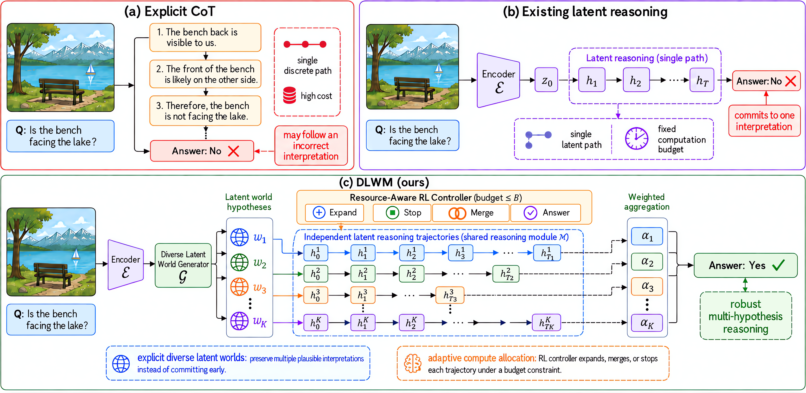

#  DLWM: Diverse Latent World Models for Efficient Multimodal Reasoning

[](https://arxiv.org/abs/2606.15160)
[](https://dawae111.github.io/DLWM/)
[](#citation)

[David Huang](https://dawae111.github.io/)<sup>1</sup>, [Lianlei Shan](https://scholar.google.com/citations?user=V5YWfWgAAAAJ)<sup>2</sup><br>
<sup>1</sup> University of Toronto &nbsp; <sup>2</sup> Tsinghua University

Given one image and one question, DLWM explores several possible interpretations in parallel. A learned controller decides which reasoning paths to expand, stop, or merge, and when to answer using the remaining paths.



## 📰 News

- `2026-11-19` 🔥 The [DLWM project page](https://dawae111.github.io/DLWM/) is live.
- `2026-11-18` 🔥 DLWM implementation released, including training scripts and evaluation adapters.
- `2026-06-13` 🔥 DLWM submitted to [arXiv](https://arxiv.org/abs/2606.15160).

## 🚀 Quick Start

### 1. Install

```bash
git clone https://github.com/Dawae111/DLWM.git
cd DLWM
conda create -n dlwm python=3.11 pip -y
conda activate dlwm
```

**Try the controller on CPU.** These tests run without model weights or benchmark data.

```bash
python -m pip install torch==2.6.0 "PyYAML>=6,<7"
python -m unittest -v tests.test_dlwm_modules tests.test_dlwm_data_protocol
```

**Train or run the 7B model.** Install the full dependencies on Linux with CUDA. If you already have a trained DLWM checkpoint, skip to [inference](#4-run-inference-and-evaluation).

```bash
python -m pip install -r requirements.txt
```

### 2. Prepare data

Set the local GQA and VQAv2 paths in the [data configuration](configs/data/dlwm_official_train.yaml), then build the training manifest.

```bash
python scripts/prepare_dlwm_data.py --config configs/data/dlwm_official_train.yaml
```

Training uses GQA balanced train, VQAv2 train2014, and ScienceQA train. MMVP is reserved for zero-shot evaluation.

### 3. Train

**Stage 1 · Learn the worlds.** Train the generator, shared reasoner, and scorer with answer supervision and an orthogonality penalty that encourages distinct hypotheses.

```bash
bash scripts/finetune_dlwm_stage1_7b.sh
```

**Stage 2 · Learn the controller.** Set `checkpoint_name` in the [Stage 2 configuration](configs/train/dlwm_stage2_rl_7b.yaml) to the Stage 1 checkpoint. REINFORCE updates the controller using answer correctness and the cost of reasoning.

```bash
bash scripts/finetune_dlwm_stage2_7b.sh
```

The example configs use score-weighted merging. For the equal-weight merge in the revised manuscript, set `dlwm_merge_mode: fixed` and `dlwm_merge_fixed_beta: 0.5`. [Merge settings](REPRODUCIBILITY.md#merge-beta)

### 4. Run inference and evaluation

Set `checkpoint` in the [evaluation configuration](configs/eval/dlwm_7b.yaml) to your trained Stage 2 checkpoint.

<details>
<summary>Ask a question about the bench in Figure 1</summary>

Run this example from the repository root.

```python
from pathlib import Path
import yaml
from evaluation.evaluation import DLWMEvaluator

config = yaml.safe_load(Path("configs/eval/dlwm_7b.yaml").read_text())
evaluator = DLWMEvaluator(config)
result = evaluator.predict({
    "question": "Is the bench facing the lake?",
    "images": [str(Path("docs/assets/bench.webp").resolve())],
})
print(result["prediction"])
```

</details>

To evaluate on GQA, set `questions_file` and `image_root` in the same config.

```bash
python evaluation/evaluation.py --config configs/eval/dlwm_7b.yaml --benchmark GQA
```

Results are saved under `evaluation/results/dlwm_7b/` in `GQA/predictions.jsonl` and `summary.json`.

## 🧩 Architecture

| Component | Role |
| --- | --- |
| World generator | Creates several hypotheses from one image–question representation using learned world embeddings. |
| Shared reasoner | Updates each active world independently with the same Transformer. |
| Controller | Chooses expand, stop, merge, or answer within the compute budget. |
| Prediction head | Weights and combines the surviving worlds’ next-token probabilities. |

See the [architecture figure](https://dawae111.github.io/DLWM/#architecture) and [model implementation](src/model/dlwm_modules.py).

## 📚 Documentation and support

- [Technical documentation](DLWM_README.md) covers model components and configuration.
- [Usage guide (中文)](DLWM_USAGE_GUIDE.md) covers training, inference, and troubleshooting.
- [Reproducibility guide](REPRODUCIBILITY.md) covers evaluation protocols, multi-seed runs, ablations, and available artifacts.
- [GitHub Issues](https://github.com/Dawae111/DLWM/issues) is the place for questions and bug reports.

<a name="citation"></a>

## 📖 Citation

```bibtex
@misc{huang2026dlwmdiverselatentworld,
      title={DLWM: Diverse Latent World Models for Efficient Multimodal Reasoning}, 
      author={David Huang and Lianlei Shan},
      year={2026},
      eprint={2606.15160},
      archivePrefix={arXiv},
      primaryClass={cs.CV},
      url={https://arxiv.org/abs/2606.15160}, 
}
```

## 🤝 Acknowledgments

- [Latent Visual Reasoning (LVR)](https://github.com/VincentLeebang/lvr) — latent visual reasoning implementation.
- [Qwen2.5-VL](https://huggingface.co/Qwen/Qwen2.5-VL-7B-Instruct) — multimodal backbone in this release.
- [Qwen-VL-Series-Finetune](https://github.com/2U1/Qwen-VL-Series-Finetune) — training infrastructure.
- [InternVL](https://github.com/OpenGVLab/InternVL) — data packing implementation.

## 📄 License

DLWM is released under the [Apache License 2.0](LICENSE). The portions adapted from InternVL retain their [MIT license](licenses/InternVL-MIT.txt).
